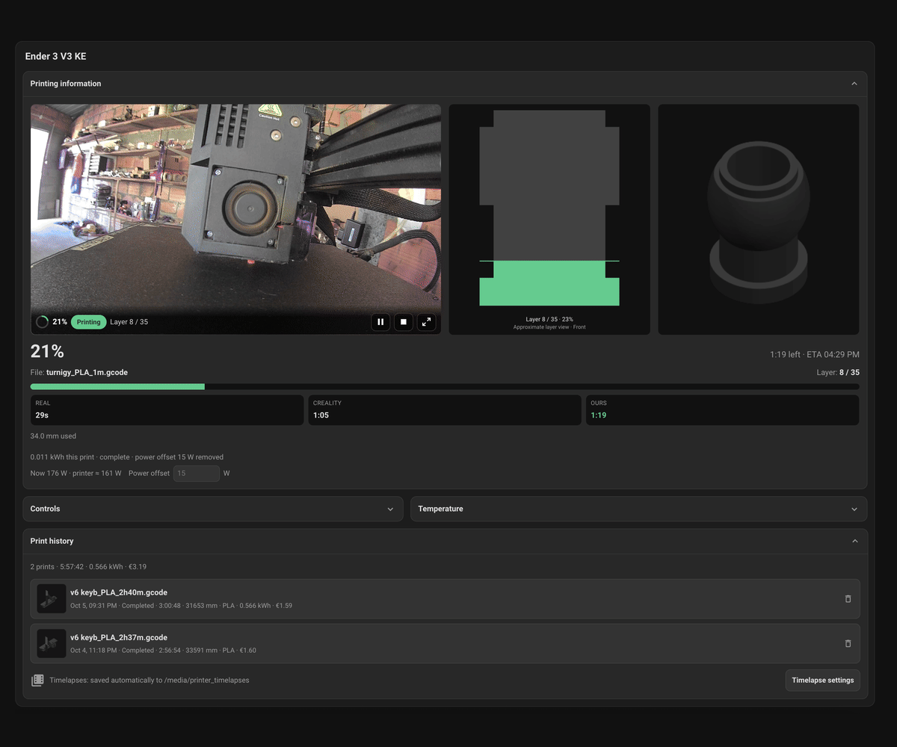
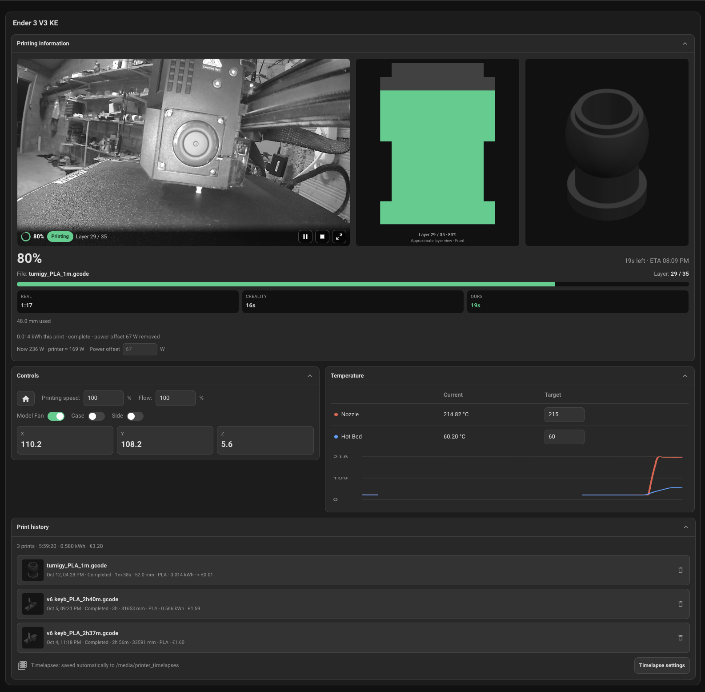

# Home Assistant Creality Integration

> This is an **unofficial** integration that started as a weekend project to get some things I was missing from the official interface.
> 
> It is not made, endorsed or supported by Creality (Shenzhen Creality 3D Technology Co., Ltd.). The Creality name is a trademark of its owner and is used only to identify the printers this integration works with.

Home Assistant integration for Creality printers running klipper firmware. It is developed and tested on the Ender 3 V3 KE; other models with the same firmware may work. It talks to the printer directly over your network: no Creality Cloud, no account, no extra add-on.

**Runs on stock firmware:** no root, no Moonraker, no Creality Cloud. The integration only uses the endpoints the printer serves out of the box (WebSocket `:9999`, HTTP `:80`, and the camera on `:8080` or `:8000`).





## Features

This project focuses on what happens around a print:
- **G-code silhouette**: a 2D front or side view of the actual object, built from the job's real G-code and filled up to the current layer
- **Per-print energy and cost**: energy measured from a smart plug or whole-room meter's recorder history, with the room's baseline subtracted, and saved with material and electricity costs ( work in progress :) )
- **Print history**: finished prints saved with costs, thumbnails and their timelapse, and a **Print again** button when the G-code is still available
- **Timelapses**: play or download the printer's timelapse, or save every finished print's timelapse (and its G-code) to a folder or NAS share automatically
- **Error-code database**: printer error codes are shown as readable messages with a severity, from a database built from the official Creality wiki and shipped with the integration
- **Bundled cards**: the full card and a compact card are served and registered by the integration itself

## Highlights

- **Its own dashboard card.** A bundled command center with live camera, progress, temperatures and controls in one view. It is served by the integration and registered automatically; no separate frontend plugin or manual resource.
- **A compact card too.** `custom:creality-compact-card` puts a camera preview (tap to enlarge), the G-code view, status, layers, ETA and power in half a dashboard section. See the [guide](docs/guide.md#the-compact-card).
- **Local only.** Everything runs on your LAN. Creality Cloud is never contacted. See [Privacy](#privacy) for what stays where.
- **Printer power control.** Link a smart plug and the card switches to a compact offline view with a **Turn on printer** button while the printer is off.
- **Cost and energy per print.** Pick a power or energy sensor and the card measures each print's energy from recorder history, subtracts the room's baseline for whole-room meters, and saves the print to history with material and electricity costs.
- **G-code silhouette.** A front or side view of the real object, built from the job's G-code and filled up to the current layer.
- **Timelapses.** Play or download the printer's timelapse when a job ends, or save every timelapse automatically to a folder or NAS share, organised by date.
- **Print again.** Each job's G-code is kept in the same folder, so a saved print can be started again from the history with one button.
- **Camera.** MJPEG for the KE, proxied through Home Assistant. Printers that report WebRTC support (for example the K1C or K2 on newer firmware, untested) stream through Home Assistant's go2rtc. The card also accepts any other Home Assistant camera entity. See [Camera](docs/guide.md#camera).
- **Readable errors.** Printer error codes are translated using a database built from the official Creality wiki and shown as a [banner on the card](docs/guide.md#banners).

> [!NOTE]
> You still need a slicer (Creality Print, OrcaSlicer, …) to slice the model and send it to the printer, or start the job from the printer's screen. This integration monitors and controls jobs once they are running, and can start a print from the history again ([Print again](docs/guide.md#print-again)).

## Supported printers

| Printer | Status |
|---------|--------|
| Ender 3 V3 KE | **Tested.** Developed on this printer; MJPEG camera. |

Setup checks WebSocket `:9999` and `GET /info`, so a printer that doesn't speak this protocol fails at setup instead of half-working. The integration creates the same entities for every model, so a control for hardware your printer lacks (for example a side fan or chamber light) may still appear. If you try an untested model, an issue saying what worked and what didn't is very welcome.

## Quick start

1. Install the integration, then restart Home Assistant:
   - **HACS:** HACS → ⋮ → **Custom repositories** → add `https://github.com/filipeamorimdev/home-assistant-creality` with type **Integration**, then open **Creality KE Firmware** and **Download**. Or use this link: [](https://my.home-assistant.io/redirect/hacs_repository/?owner=filipeamorimdev&repository=home-assistant-creality&category=integration)
   - **Manually:** copy `custom_components/creality` into your Home Assistant `config/custom_components/` folder.
2. Settings → Devices & services → **Add Integration** → **Creality**, and enter the printer's IP address.
3. Edit a dashboard → **Add card** → **Creality Printer**. The editor finds the printer's entities by itself.

### Example

A card with power control and cost tracking (entity IDs are illustrative; the editor fills them in for you):

```yaml
type: custom:creality-card
title: Ender 3 V3 KE
status: sensor.ender_3_v3_ke_print_status
camera: camera.ender_3_v3_ke_printer_camera
printer_switch: switch.printer_plug
print_energy: sensor.printer_plug_power
```

While the plug is off, the card shrinks to a power-on button and the print history with each job's energy and cost:


When a print ends, **Save to history** asks for the filament price per kg and the electricity price per kWh (remembered for the next print) and stores the job's total cost. An automation can use the integration's entities like any others, for example to notify when a print ends:

```yaml
triggers:
  - trigger: state
    entity_id: sensor.ender_3_v3_ke_print_status
    from:
      - printing
      - paused
    to: completed
actions:
  - action: notify.notify
    data:
      message: "Print finished: {{ states('sensor.ender_3_v3_ke_current_object') }}"
```

The `from:` condition matters. Print status is `offline` while the printer is disconnected and during a Home Assistant restart, then shows the printer's current state again once it reports in. A trigger with only `to: completed` would fire again after every restart or reconnect while the printer still reports the last job as finished. The status values are `idle`, `processing`, `printing`, `paused`, `completed`, `stopped`, `error` and `offline`; add `stopped` to `to:` to be told about cancelled jobs too.

## Privacy

The integration is built to keep your printer and your prints on your own network:

- **Only the printer and Home Assistant talk.** Home Assistant connects to the printer's IP on your LAN and nowhere else. There is no Creality account, no cloud relay, no telemetry or analytics, and the bundled cards load no external scripts, fonts or images.
- **Your data stays in Home Assistant.** Print history (with costs and thumbnails) is stored in your Home Assistant's own user data, falling back to the browser's local storage. Energy figures come from your recorder history. G-code profiles are kept in memory only.
- **Files go where you put them.** Timelapses and G-code are copied only when you set a folder, and only to that folder (local disk or your own NAS share). Nothing is uploaded anywhere else.
- **Camera and video go through Home Assistant.** The browser never connects to the printer directly. Camera streams and timelapses are proxied by Home Assistant behind its login; timelapse links are signed and expire after an hour.
- **Error codes work offline.** The error-code database ships with the integration and is never looked up online at runtime.

A few things are outside the integration's control:

- **The printer itself may still go online.** Stock firmware can talk to Creality Cloud on its own, for example if it was paired with Creality Print or the Creality Cloud app. The integration doesn't need the printer to reach the internet, so if you want it fully offline, block its internet access on your router or put it on an isolated VLAN or IoT network that Home Assistant can still reach.
- **The LAN link is unencrypted and unauthenticated.** That is how stock firmware works: the WebSocket (`:9999`), HTTP (`:80`) and camera ports accept anyone on the same network. Keep the printer on a network you trust, and don't forward these ports to the internet.
- **Remote access is up to your Home Assistant setup.** If you reach Home Assistant from outside your home (Nabu Casa, a reverse proxy, a VPN), the card and camera travel the same way as the rest of your dashboard.

## Documentation

- [Setup and reference guide](docs/guide.md): entities, options, card layout, camera modes, timelapse saving, energy measurement, time estimates and limitations

## FAQ

**Do I need to root the printer or install Moonraker?**
No. It uses only what the stock firmware serves on your LAN (WebSocket `:9999`, HTTP `:80`, camera `:8080` / `:8000`).

**Does it use Creality Cloud or need an account?**
No. Everything stays on your network. The printer's own firmware may still reach Creality Cloud by itself; see [Privacy](#privacy) for how to keep it offline.

**Which printers work?**
The Ender 3 V3 KE is tested; K1-series, K2-series and other printers on Creality's stock LAN firmware are untested but may work. See [Supported printers](#supported-printers).

**Can I start a print from Home Assistant?**
Only again: a print saved in Print history can be started again with **Print again**. New jobs still come from your slicer or the printer's screen.

**Can I use a different camera, for example a webcam pointed at the printer?**
Yes. The card's camera option accepts any Home Assistant camera entity.

**The camera shows no live video on a WebRTC printer (K1C / K2).**
WebRTC needs Home Assistant's go2rtc integration. Home Assistant OS and Container include it; Home Assistant Core installs do not bundle the go2rtc binary. Without go2rtc the camera falls back to still images where the printer serves them. See [Camera](docs/guide.md#camera).

**Can I add more than one printer?**
Yes. Add the integration once per printer, by IP address. Each printer gets its own device, and the card editor picks one printer per card.

**Why are some entities `unavailable`?**
The printer is off or disconnected. Telemetry and controls go `unavailable` instead of showing stale values, Print status shows `offline`, and the integration reconnects by itself when the printer comes back.

**Is the CFS (multi-color unit) supported?**
No, CFS-specific features are out of scope for now.