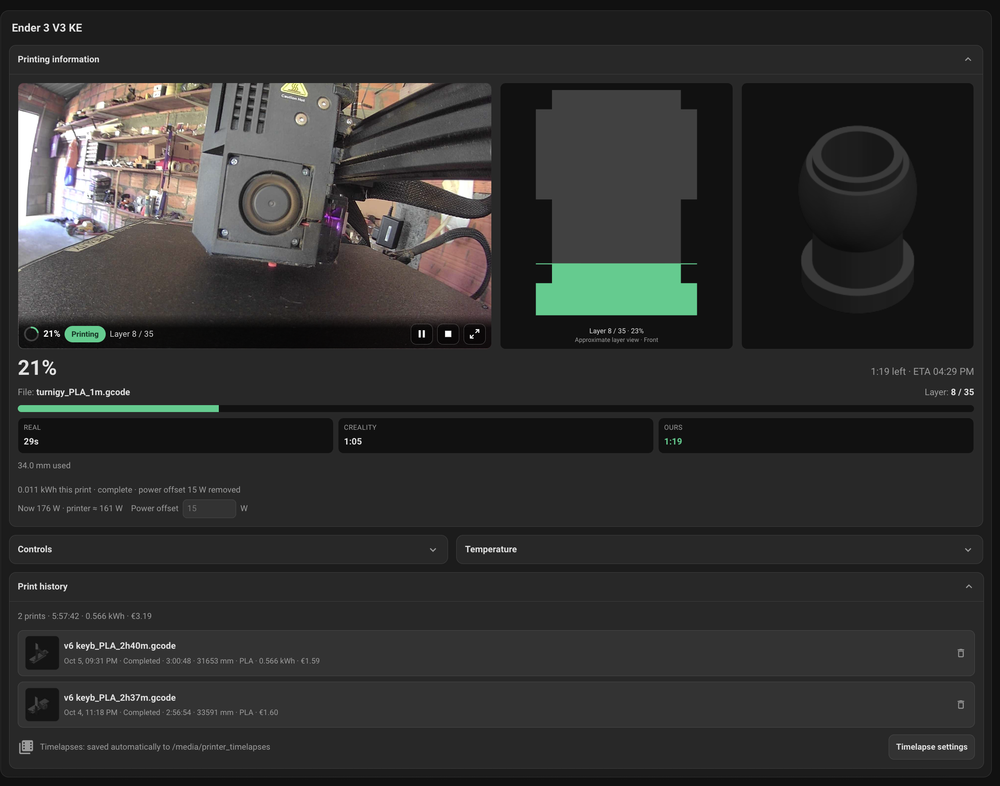
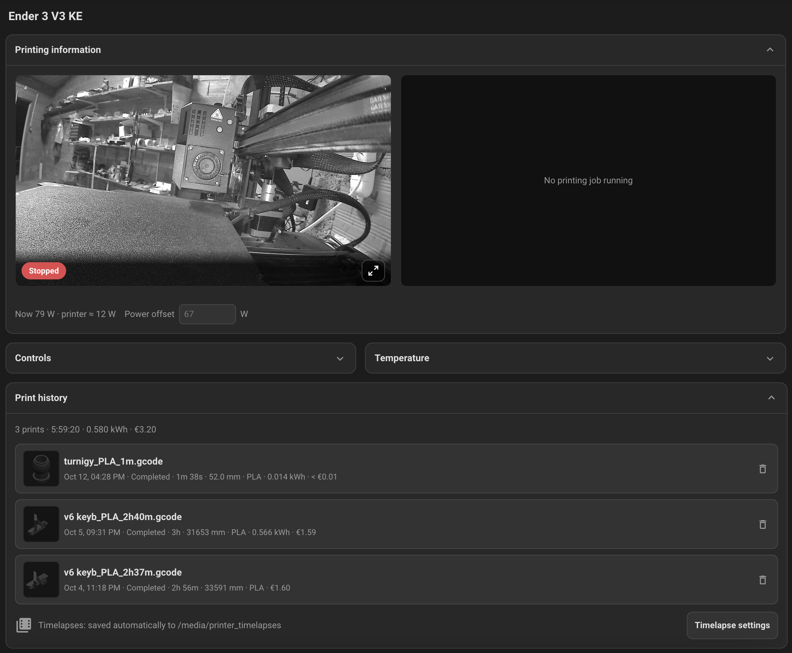
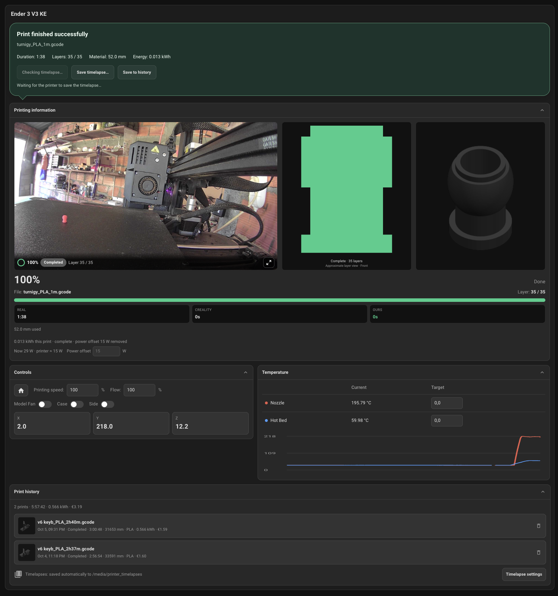
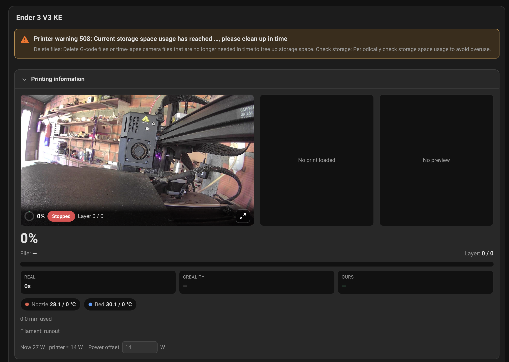
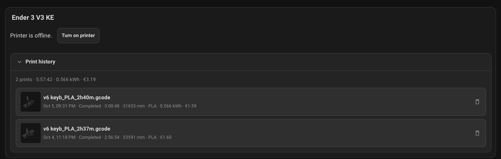
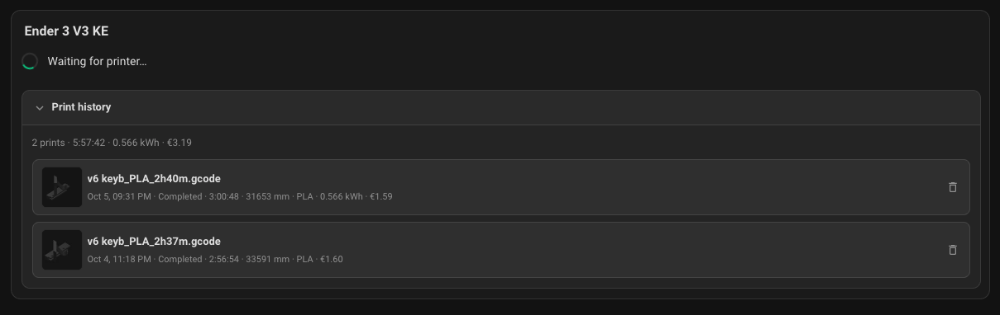
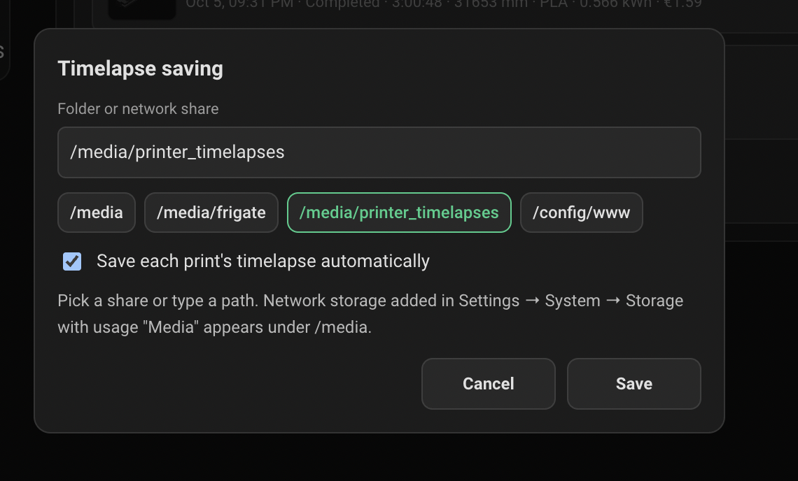
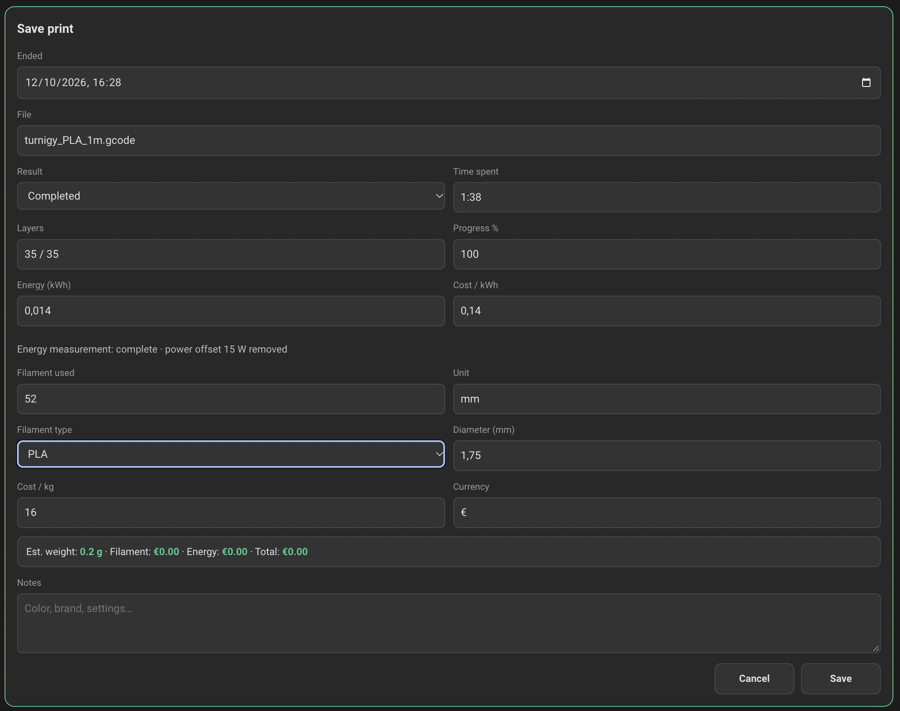
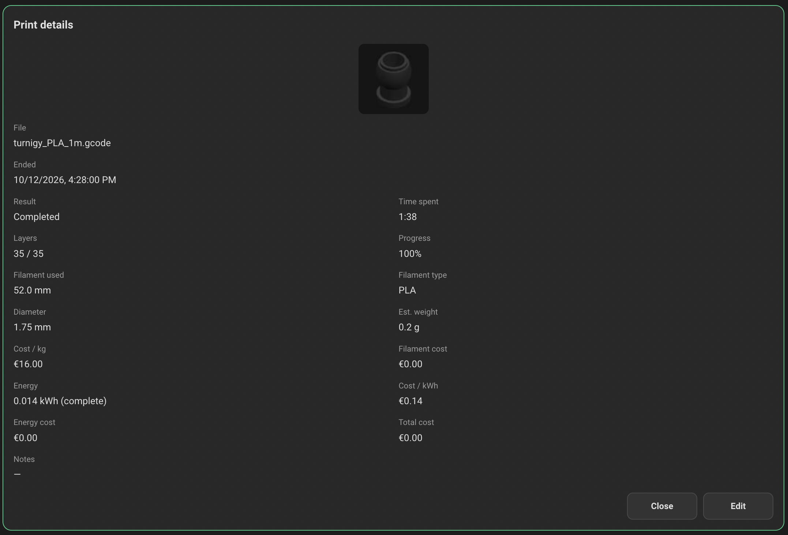

# Setup and reference guide

Full setup and feature reference for the Creality integration (listed in Home Assistant as **Creality KE Firmware**). It runs on Creality's stock LAN firmware with no root, Moonraker or cloud. It is tested on the Ender 3 V3 KE; other models are untested but may work, see [Supported printers](../README.md#supported-printers). For an overview, see the [README](../README.md).

## Contents

- [Setup](#setup)
- [Features at a glance](#features-at-a-glance)
- [Entities](#entities)
- [Integration options](#integration-options)
- [The Creality card](#the-creality-card)
- [The compact card](#the-compact-card)
- [Camera](#camera)
- [Current print preview and layer overlay](#current-print-preview-and-layer-overlay)
- [G-code print profile](#g-code-print-profile)
- [Completion banner and timelapses](#completion-banner-and-timelapses)
- [Print energy](#print-energy)
- [Print history](#print-history)
- [Time estimates](#time-estimates)
- [Availability and command errors](#availability-and-command-errors)
- [Error codes DB](#error-codes-db)
- [Limitations](#limitations)

## Setup

1. Settings → Devices & services → **Add Integration** → **Creality**
2. Enter the printer LAN IP (and optional name). Optionally enter a [timelapse folder](#saving-timelapses) (it can also be set later from the card). The flow tests WebSocket `:9999` and `GET /info`.
3. Edit a dashboard → **Add card** → choose **Creality Printer**. The bundled card is already registered.

The card is delivered from `custom_components/creality/frontend/creality-card.js` by the integration. After updating, restart Home Assistant and hard-refresh the browser if the old card still shows (the card URL is versioned).

## Features at a glance

**Monitoring**

- Print status, progress, current file, working / total layers (latched, so they survive the printer resetting them after a finish), job time and Creality's time left
- Nozzle and bed temperatures, print speed, used material, filament status
- Toolhead position, live toolhead speed and extrusion flow (disabled by default)
- Lifetime totals from the printer: jobs, print time, filament used
- Filament runout (`materialStatus`) kept separate from errors; storage warning `err.key` 508 is **not** treated as fatal
- Human-readable error messages and severity from a shipped Creality wiki database
- Online / connection state; entities go `unavailable` while disconnected instead of showing stale values

**Control**

- Pause / resume / stop, home XY then Z
- Nozzle and bed target temperatures
- Separate print speed and flow multipliers
- Model, case and side fans; chamber light
- Failed commands raise a Home Assistant error (shown as a notification in the card)

**Media**

- Camera: MJPEG, live **WebRTC** through Home Assistant's go2rtc, or a custom URL; a missing camera never blocks setup
- Current print preview image (the printer's thumbnail) with an approximate layer overlay (only while the G-code profile tile is not showing a silhouette)
- **G-code print profile**: a front or side silhouette of the actual object, filled up to the current layer
- **Timelapse** playback and download from the completion banner, streamed from the printer through Home Assistant
- Optional **timelapse auto-save** to a folder or NAS share when a print finishes

**Energy and history**

- Per-print energy from an external smart-plug power or energy sensor, computed by the card from recorder history (no browser needs to stay open)
- Room-baseline subtraction for whole-room power meters
- Print history saved from the card, with material and energy costs and thumbnails, shared across browsers

**Command center**

- Bundled `custom:creality-card`, the dashboard command center, with a visual editor that discovers this integration's entities automatically
- Bundled `custom:creality-compact-card` for overview dashboards: camera preview, G-code view, status, layers, ETA and power in a small tile
- Layout that adapts to the configured entities and to phone widths; camera status bar with print actions, and a large camera popup with snapshot and fullscreen
- Completion / stopped banner, printer error and warning banner, temperature history chart
- Optional printer power switch: compact offline view with a "Turn on printer" button

**Starting prints:** a saved print can be started again from Print history (see [Print again](#print-again)); new jobs still start from your slicer (Creality Print, OrcaSlicer, …) or the printer's screen.

## Entities

IDs below use an example device named *Ender 3 V3 KE*; yours follow your device name.

| Entity | Notes |
|--------|-------|
| `sensor.*_print_status` | `idle`, `processing`, `printing`, `paused`, `completed`, `stopped`, `error` or `offline`; `err_*` attributes for the current printer error |
| `sensor.*_print_progress` | % |
| `sensor.*_current_object` | Current file name |
| `sensor.*_working_layer` / `*_total_layers` | Latched while printing / paused |
| `sensor.*_print_job_time` / `*_print_time_left` | From the printer |
| `sensor.*_used_material_length` / `*_filament_status` | |
| `sensor.*_nozzle_temperature` / `*_bed_temperature` | |
| `sensor.*_print_speed` | Speed setting |
| `sensor.*_position_x/y/z` | Disabled by default (very chatty while printing) |
| `sensor.*_toolhead_speed` / `*_extrusion_flow` | `realTimeSpeed` mm/s, `realTimeFlow` mm³/s; disabled by default |
| `sensor.*_total_print_jobs` / `*_total_print_time` / `*_total_filament_used` | Printer lifetime counters (diagnostic, restored across restarts) |
| `sensor.*_error_key` / `*_error_message` | Wiki-backed `err.key` text + severity |
| `sensor.*_timelapse_saving` | Timelapse saving status (diagnostic; `off` without a folder) |
| `binary_sensor.*_filament_runout` | `materialStatus == 1` |
| `binary_sensor.*_online` | WebSocket connected |
| `button.*_pause_print` / `*_resume_print` / `*_stop_print` | |
| `button.*_home_xy_then_z` | Homes X and Y, then Z once the printer is idle again |
| `number.*_nozzle_target` / `*_bed_target` | Target temperatures |
| `number.*_print_tuning` | Print speed multiplier (feed rate only) |
| `number.*_flow_multiplier` | Extrusion flow multiplier |
| `fan.*_model_fan` / `*_case_fan` / `*_side_fan` | |
| `light.*_light` | Chamber LED (`lightSw`) |
| `camera.*_printer_camera` | See [Camera](#camera) |
| `image.*_current_print_preview` | See [Current print preview](#current-print-preview-and-layer-overlay) |

## Integration options

Settings → Devices & services → **Creality** → **Configure**:

| Option | Purpose |
|--------|---------|
| Camera mode | `auto`, `mjpeg`, `webrtc` or `custom` (see [Camera](#camera)) |
| Custom camera URL | Required in `custom` mode; `http(s)` MJPEG stream or snapshot URL |
| Timelapse folder / Save each print's timelapse automatically | Where timelapses are saved, and whether each finished job's video is copied there by itself (see [Saving timelapses](#saving-timelapses)); also offered when adding the printer and in the card |

## The Creality card

The card is the command center: the camera, the print, and the controls in one view, then the result, timelapse and history when the job ends. Add **Creality Printer** from the card picker. New cards pre-fill entities from this integration's entity registry by stable unique ID, so renamed entities and numeric suffixes are found. There is no required device name. All defaults belong to one printer: HA's suggested entities take priority, otherwise the first matching entity in alphabetical order selects the printer. Disabled or absent entities are not filled. Existing saved cards are never overwritten; add a new card (or use the editor) to pick up entities added in later versions.

The editor groups settings into:

- **Printing information**: status, progress, preview, file, layers, times, material, filament
- **Camera & layout**: camera entity, camera height (`camera_aspect`: 21:9, 16:9 default, 4:3, 1:1) and `hide_tiles` (hide the 2D G-code view and/or printer preview from the top row)
- **Power / energy**: `print_energy` (smart-plug power or energy meter) and an optional `printer_switch`
- **Print actions (camera status bar)**: pause, resume, stop
- **Controls**: home, speed and flow multipliers, print speed, fans, X/Y/Z position
- **Temperature**: nozzle, bed and their targets

### Layout

**Printing information** spans the full width.

- **Top row:** the camera (double width), the G-code profile and the printer thumbnail. With no print job running, the profile and thumbnail become one "No printing job running" tile next to the camera. Under 600 px the camera takes the full row and the other two tiles sit below it.
- **Camera status bar:** along the bottom of the camera, a progress ring, the status and the current layer on the left; on the right, Pause / Resume / Stop (only the ones that apply right now) and the expand button. Without a camera the bar sits at the top of the second row.
- **Camera popup:** the expand button opens a large view with snapshot download, fullscreen and a status / progress / ETA line. Only one camera stream runs at a time: the tile pauses while the popup is open.
- **Second row:** a large progress percentage with time left and finish time, then file, layer, progress bar, timings, nozzle and bed temperatures, material and energy.

Below, **Controls** (home, speed and flow, fans, X/Y/Z) sits in the left column and **Temperature** (targets and a history chart) in the right, followed by **Print history**.

Anything whose entity is not selected in the editor is hidden and the remaining tiles fill the space; the card never shows something only because the integration provides it.



*Running job: camera with pause / stop on the status bar, the G-code silhouette filled up to layer 8 of 35, the printer's thumbnail, time left and finish time, the real job time and Creality's time left and the energy used so far with the power offset removed.*



*Printer on with no job running: the camera bar keeps only the status badge, one "No printing job running" tile replaces the G-code and thumbnail tiles, the progress and timing rows are hidden, and the energy line shows the meter's live reading, the printer's share and the **Power offset**. Controls and Temperature start collapsed; print history shows the timelapse auto-save status.*

### Banners

- **Completion / stopped banner** when the printer reports a finished or stopped job: result, file, duration, layers, material and energy, with **Save to history** and timelapse buttons. A reported 100% alone does not count as success. Final stats are frozen for the browser session and the banner clears when another print starts.
- **Printer error / warning banner** for any nonzero printer error code, with the wiki message filled in. Close it with **×**; that browser keeps it hidden until the code or its value changes, or the printer reports no error and it later recurs.
- **Filament runout banner** while the configured filament status reports `runout`, with a **Heat nozzle to 240 °C** button (shown when the nozzle target is configured) for unloading and loading new filament. **×** hides it until the next runout.
- **Replace filament** button in Controls (shown when the nozzle target is configured) sets the nozzle target the same way at any time. The temperature is the card option **Replace filament temperature** (`filament_change_temp`, default 240 °C), which the runout banner uses too.



*Finished job: the completion banner with duration, layers, material and energy, **Save timelapse…** and **Save to history** while the card waits for the printer to save the timelapse; the G-code silhouette is filled to the last layer.*



*Warning 508 (storage almost full) with the wiki's message and suggested fix. It is a warning, not a print failure.*

### Printer power switch

With a `printer_switch` configured, the card shows only the offline notice, a **Turn on printer** button (while the switch is off) and print history when the switch is off or the printer is disconnected / unavailable. The full card returns when the printer is connected and the switch is not off. Without a switch, the full card always remains visible.

| Printer off | Printer starting |
|---|---|
|  |  |
| Offline notice, **Turn on printer** and print history with costs | After power-on, until the printer reports its state |

### Example card YAML

Not needed when using the editor; IDs are illustrative.

```yaml
type: custom:creality-card
title: Ender 3 V3 KE
camera: camera.ender_3_v3_ke_printer_camera
camera_aspect: "16:9"
hide_tiles: []  # e.g. [profile] or [profile, preview]
preview: image.ender_3_v3_ke_current_print_preview
print_energy: sensor.ender_3_v3_ke_print_energy
printer_switch: switch.printer_power
status: sensor.ender_3_v3_ke_print_status
progress: sensor.ender_3_v3_ke_print_progress
object: sensor.ender_3_v3_ke_current_object
layer: sensor.ender_3_v3_ke_working_layer
total_layers: sensor.ender_3_v3_ke_total_layers
job_time: sensor.ender_3_v3_ke_print_job_time
time_left: sensor.ender_3_v3_ke_print_time_left
used_material: sensor.ender_3_v3_ke_used_material_length
filament: sensor.ender_3_v3_ke_filament_status
home: button.ender_3_v3_ke_home_xy_then_z
print_speed: sensor.ender_3_v3_ke_print_speed
print_tuning: number.ender_3_v3_ke_print_tuning
flow_tuning: number.ender_3_v3_ke_flow_multiplier
model_fan: fan.ender_3_v3_ke_model_fan
case_fan: fan.ender_3_v3_ke_case_fan
side_fan: fan.ender_3_v3_ke_side_fan
position_x: sensor.ender_3_v3_ke_position_x
position_y: sensor.ender_3_v3_ke_position_y
position_z: sensor.ender_3_v3_ke_position_z
pause: button.ender_3_v3_ke_pause_print
resume: button.ender_3_v3_ke_resume_print
stop: button.ender_3_v3_ke_stop_print
nozzle: sensor.ender_3_v3_ke_nozzle_temperature
nozzle_target: number.ender_3_v3_ke_nozzle_target
bed: sensor.ender_3_v3_ke_bed_temperature
bed_target: number.ender_3_v3_ke_bed_target
```

## The compact card

**Creality Printer (compact)** (`custom:creality-compact-card`) fits a printer in
half a dashboard section. Add it from the card picker; like the full card it
pre-fills the entities of one printer, and the editor groups the rest under
Print, Power and Print actions.

- **Header:** title and the print status badge (`Printing`, `Paused`, `Idle`,
  `Completed`, `Error`, `Offline`, …).
- **Media row:** a small live camera preview with an enlarge button (the same
  popup as the full card: snapshot, fullscreen and a status / progress / layer /
  ETA line; clicking the preview opens it too) and the G-code silhouette, filled
  up to the current layer (click to switch front / side). While the silhouette
  is not available the printer's thumbnail (`preview`) stands in.
- **Job line:** file name, progress percentage and bar, and Pause / Resume /
  Stop when they apply.
- **Stats:** layer (current / total), ETA with the time left, elapsed time
  and power.
- **Banners:** printer errors / warnings and filament runout, as one-line
  versions of the full card's banners (a warning dismissed on either card stays
  dismissed on both).

With no job running, the job line and the layer, ETA and elapsed stats are
hidden (power stays) and the G-code tile reads "No printing job running". Anything whose
entity is not configured is left out. With a `printer_switch`, a powered-off or
disconnected printer shows the offline notice and **Turn on printer** button.

**Power** uses the same `print_energy` key as the full card. For a power sensor
(W or kW) the card shows the printer's share: the reading minus the **Power
offset** set on the full card, or else minus the meter's reading just before the
printer was last switched on (refreshed every 5 minutes). With a dedicated smart
plug that is simply its reading; hover the value to see the meter reading and
offset. An energy counter (Wh / kWh) has no live power, so its total is shown.

```yaml
type: custom:creality-compact-card
title: Ender 3 V3 KE
status: sensor.ender_3_v3_ke_print_status
camera: camera.ender_3_v3_ke_printer_camera
preview: image.ender_3_v3_ke_current_print_preview
progress: sensor.ender_3_v3_ke_print_progress
object: sensor.ender_3_v3_ke_current_object
layer: sensor.ender_3_v3_ke_working_layer
total_layers: sensor.ender_3_v3_ke_total_layers
job_time: sensor.ender_3_v3_ke_print_job_time
time_left: sensor.ender_3_v3_ke_print_time_left
filament: sensor.ender_3_v3_ke_filament_status
print_energy: sensor.printer_plug_power
printer_switch: switch.printer_plug
pause: button.ender_3_v3_ke_pause_print
resume: button.ender_3_v3_ke_resume_print
stop: button.ender_3_v3_ke_stop_print
```

## Camera

| Mode | Behavior |
|------|----------|
| `auto` | MJPEG on `:8080` unless telemetry reports `webrtcSupport` |
| `mjpeg` | `http://{host}:8080/?action=stream`; stills from `?action=snapshot` |
| `webrtc` | Live WebRTC through Home Assistant's go2rtc (see below) |
| `custom` | Your own `http(s)` MJPEG stream or snapshot URL; a `…/call/webrtc_local` URL is treated as WebRTC |

Missing camera never blocks setup.

### MJPEG (the KE)

In `mjpeg` mode, and in `auto` mode on printers that don't report WebRTC
support, Home Assistant opens the printer's `:8080/?action=stream` and relays
it. The browser only talks to Home Assistant, so the camera also works from
outside your LAN. Each open view (card tile, popup, another browser) opens its
own connection to the printer. Snapshots come from `:8080/?action=snapshot`.

### WebRTC printers (e.g. K1C / K2 on newer firmware, untested)

Printers that report `webrtcSupport` (or cameras set to `webrtc`) expose the
go2rtc source `webrtc:http://<printer>:8000/call/webrtc_local#format=creality`.
Home Assistant's built-in **go2rtc** integration (part of `default_config`)
negotiates WebRTC with the printer and serves live video and snapshots; no
extra add-on is needed on Home Assistant OS or Container, which include the
go2rtc binary. **Home Assistant Core** installs don't bundle go2rtc: install a
go2rtc binary yourself and set up the go2rtc integration, as described in Home
Assistant's go2rtc documentation. It requires go2rtc 1.9.10 or newer (HA 2026.2 ships
1.9.14). Without go2rtc the camera does not advertise streaming and falls back
to `:8080/?action=snapshot` stills where the printer offers them. The bundled
card shows streaming cameras with Home Assistant's own live camera view and
keeps the lightweight proxied MJPEG image for MJPEG printers such as the KE.

### Using another camera

The card's **Camera** option accepts any Home Assistant camera entity, not only
this integration's, for example a webcam or IP camera pointed at the printer.
Cameras that support streaming use Home Assistant's live camera view; others
are shown through Home Assistant's camera proxy. To use a different stream for
the integration's own camera entity, set camera mode `custom` with its URL.

## Current print preview and layer overlay

The **Current print preview** image is fetched by HA from the printer's
`/downloads/original/current_print_image.png` endpoint. Requests are limited to
once per 30 seconds per job, with a 5-second timeout and 2 MiB size limit.
The cache is cleared when the filename, print start time, or print ID changes.
Paused/completed jobs retain their image while their job metadata remains.
Firmware without this endpoint leaves the entity unavailable; `preview_reason`
reports the fetch status. Allow up to 30 seconds for the first image.

In the card, the thumbnail shows a rising layer indicator, a dimmed unprinted
area and a lightly highlighted printed area, labelled with current / total
layers. It holds while paused and reaches the top on the printer's confirmed
completion. This is an **approximate layer view** over the printer's angled
thumbnail, not a geometric cross-section; for that, see the G-code profile.
Saved thumbnails remain plain images, without the overlay.

## G-code print profile

Next to the camera, the card shows a 2D silhouette of the object being printed,
with the layer caption underneath. It is built from the job's real G-code:
printed layers are filled, the rest is dimmed, and a line marks the current
layer. Click it to switch between the front (X against Z) and side (Y against
Z) view. Holes and overhangs in that projection are visible; the skirt and
start/end G-code are left out. The printer thumbnail keeps its own tile.

Home Assistant downloads the G-code once per job from the printer's
`/downloads/gcode/<file>` endpoint (verified on K1-family firmware) and keeps
only the small profile in memory (it is rebuilt after an HA restart). The
printer serves files at roughly 0.5 MB/s, so a large job's profile can take a
minute to appear; the tile says when it is reading, unavailable or failed.
Jobs printed from USB storage, or firmware without the endpoint, have no
profile. Failed downloads are retried after 5 minutes.

## Completion banner and timelapses

When the printer recorded a timelapse of the job, the completion banner offers
**Play timelapse** (inline player) and **Download timelapse**. Home Assistant
looks the video up in the printer's timelapse list and streams it from the
printer through a signed, authenticated URL, so the browser does not need to
reach the printer. Play first loads the whole video into the browser (with a
progress note), so you can seek anywhere. **Save timelapse…** opens a popup:
**Download to this device** (reusing the copy already loaded for the player) or
**Save to** the configured folder or network share. The printer saves the video a little after the print
ends; the card keeps looking for five minutes. Very short prints, or prints
with timelapse turned off on the printer, have none. Videos stay on the
printer unless you [save them to a folder](#saving-timelapses) (the
browser's copy is dropped when the banner clears or the page closes), and saved
print history does not include them. Once a copy is in the folder, Play and
Download use that file instead of the printer's, also while the printer is off.

### Saving timelapses

Choose the folder in the card: **Print history** → **Timelapse settings** (or
**Folder settings…** in the Save timelapse popup). Pick one of the listed
shares or type a path, and tick **Save each print's timelapse automatically**
to copy every finished job's video without pressing anything. The same two
settings are under **Configure** on the integration and when adding the
printer. Only administrators can change them; changes apply immediately
without reconnecting to the printer.



*The folder suggestions are your media folders, their subfolders (mounted shares) and allowlisted folders.*

Automatic saving waits after a job finishes (or is stopped) until the printer
lists its timelapse (up to 30 minutes). The folder is organised as:

```text
<folder>/
  timelapses/
    20261026/
      1511 - Shiny A_PETG_2h57m.mp4     ← local start date and time, G-code name
  gcode-files/
    Shiny A_PETG_2h57m.gcode            ← kept to print the job again
```

Videos saved by older versions directly in the folder
(`<YYYY-MM-DD_HHMMSS>_<name>.mp4`) are still found and played; they are not moved.

To save to a NAS, add the share under Settings → System → Storage → **Add
network storage** with usage **Media**; it is mounted at `/media/<name>`, so
enter for example `/media/nas/timelapses` (missing subfolders are created).
Folders outside `/media` must be listed in
[`allowlist_external_dirs`](https://www.home-assistant.io/integrations/homeassistant/#allowlist_external_dirs).

- Each video is downloaded once; restarts and reconnects do not duplicate it,
  and a job that finished while Home Assistant was restarting is still picked up.
- The file is written as `.part` and renamed only when complete. If the share
  is offline the copy is retried every 5 minutes for up to 24 hours.
- Only jobs that end while the option is on are saved; older videos on the
  printer are not copied.
- The card only reports a copy while the file is really in the folder (looked
  up by the recorded path, else by the job's date and start time); a deleted or
  moved file is no longer offered.
- The diagnostic sensor **Timelapse saving** (`off`, `idle`, `waiting`,
  `saving`, `saved`, `failed`) carries `folder`, `auto_save`, `last_file`, `last_saved`, `last_error`,
  `pending`, `gcode_files` (jobs with a saved G-code) and `gcode_last_error`, e.g. for a notification automation.

### Saving G-code

With a folder set, every job that finishes or is stopped also has its G-code
copied to `gcode-files/` (whether or not timelapses are saved automatically),
from the same printer endpoint the G-code profile uses. Each content is kept
once: printing the same file again reuses the copy, and a file re-sliced under
the same name is kept next to it as `<name> (2).gcode`. Failed copies are
retried every 5 minutes for up to 24 hours; USB prints have no copy.

## Print energy

Pick the smart plug's power (W/kW) or cumulative energy (Wh/kWh/MWh) sensor as
**Power or energy sensor** in the card's Power / energy settings. The card reads
that sensor's recorder history from the print's start to its finish and
integrates it, so no browser needs to stay open during the print. The start is
the printer's `printStartTime`, or earlier when the print status already showed
the job as active before it (preparing, heating; up to 30 minutes). The sensor must be recorded by HA's recorder; gaps or
`unavailable` readings mark the total partial.

A whole-room power meter also counts everything else in the room, so the card
subtracts a **power offset** from each reading. It takes the meter value at the
moment the printer was switched on (the Printer power switch's last off→on, up
to 48 h before the print) as the offset, or, without a switch, 2 minutes
before print status last left `offline`. Only an off period of at least 5
minutes counts as the printer being switched on: a Home Assistant restart or a
Wi-Fi drop also shows the printer `offline` for a moment, and a quick plug
toggle can leave the plug's old reading in place, which would otherwise make
the printer's own draw the offset. Readings below the offset count as zero. The offset is shown with the total and saved with the print; if no
power-on is found, the full meter reading is used and labelled as such. Load that
changes in the room during the print is still counted. Offsets apply to power
(W/kW) sensors only, not cumulative energy counters.

The card also shows the meter's live reading, even when nothing is printing,
with the printer's share (reading minus offset). If the detected offset is
wrong, type your own in the **Power offset** field; it is saved per printer
with the print-history settings and used for the current and later prints.
Clear the field to go back to the automatic offset.

## Print history

**Save to history** in the completion banner opens the **Save print** form, full
screen, and stores the print with its file,
duration, layers, material, energy (with measurement quality and baseline,
correctable by hand), costs from your material price and electricity tariff,
and the thumbnail. History is kept per printer in Home Assistant's frontend
user data (falling back to browser storage), and every save merges with the
stored copy, so several browsers can save without overwriting each other.



*The **Save print** form, pre-filled from the finished job. Every field can be corrected. The filament type is taken from the file name when it names one (Creality Print names files `<model>_<material>_<time>.gcode`, e.g. `PETG`, `PLA-CF`), else the last type used; editing a saved print keeps the type chosen then. Prices per kWh and per kg are remembered for the next print (the price per kg for each filament type), and the estimated weight and costs update as you type.*



*Click a saved print in **Print history** to open its details, full screen: thumbnail, result, time, layers, filament, energy and every cost. **Edit** reopens the form to correct it. Close with ×, **Close** or Escape.*

The details also show the job's **timelapse** with **Play** and **Download**:
the copy in your timelapse folder when there is one (also while the printer is
off), otherwise the printer's while it still has it (it keeps roughly the last
50). Very short prints have no timelapse; the printer skips them.

### Print again

Rows whose G-code is available show a **Print again** button (printer icon next to the
delete button): the job has a copy in `gcode-files/`, or the printer still has
the file. It is disabled while a job runs or the printer is offline, and asks
before starting (clear the build plate first).

- If the printer still has a file with that name and the same size as the
  saved copy, that file is started.
- Otherwise the saved copy is uploaded to the printer (spaces in the name
  become `_`), checked in the printer's file list, then started. A different
  file with the same name on the printer is never replaced: the copy is
  uploaded as `<name>_<job id>.gcode`.
- Without a saved copy, a row can only be printed again while the printer
  still has the file.

## Time estimates

The cards show the real job time and Creality's own time left; the time left
and finish clock (ETA) follow the printer's estimate and update as the print
runs. Pauses are not added to the finish time.

Earlier versions also had an integration estimate ("Ours" on the card, the
**Own time estimate** switch and the estimated print time sensor). It was
removed; on upgrade the integration deletes both entities from the entity
registry. Remove `time_left_estimated` from saved card YAML; the card ignores it.

## Availability and command errors

While the printer is disconnected, telemetry and control entities report
`unavailable` instead of stale values. Print status (`offline`) and Online
stay available. After a reconnect, entities wait for the printer's
first state report; stale job data is discarded unless a job is printing,
paused or awaiting power-loss recovery. Failed commands (pause, temperatures,
fans, …) are reported to the caller as Home Assistant errors, and the card
shows them as a notification.

## Error codes DB

Shipped SQLite: `custom_components/creality/data/error_codes.sqlite`, scraped from **official Creality Wiki only**:

- [K1 Series Error Code Summary](https://wiki.creality.com/en/k1-flagship-series/k1-series-general-documents/error-code-summary) (full table)
- [Creality OS Error Code index](https://wiki.creality.com/en/printers-general-documents) (BS/BM/AC/FR/… detail pages)
- [CFS Error Code Summary](https://wiki.creality.com/en/cfs/error-code-summary)

Lookup uses the numeric part of the code (same as printer `err.key`). Letter prefixes are stored in `code_label` when known.

Refresh locally:

```bash
python scripts/update_error_codes.py
```

An unchanged scrape leaves the file untouched.

## Limitations

- Only the Ender 3 V3 KE is tested. The same entities are created for every model, so controls for hardware a printer lacks (for example a side fan or chamber light) may appear.
- Jobs can only be started again from Print history; sending a new G-code from Home Assistant is not supported (use your slicer).
- **Print again** uses the printer's start command (`opGcodeFile`) and, for files no longer on the printer, the upload endpoint slicers use (`POST /upload/<name>`). These are taken from protocol notes and slicer integrations, not confirmed on every model and firmware; a failed upload is reported and nothing is started.
- The thumbnail layer overlay is an approximation; saved thumbnails have no overlay.
- G-code profiles need the printer's download endpoint and are not available for USB prints.
- Energy downtime is not reconstructed; gaps mark totals partial.
- Saved history plays timelapses from the timelapse folder or the printer; a video in neither (deleted, folder changed, never saved) is gone. Auto-save copies only jobs that end while it is enabled.
- Creality Cloud and CFS-specific features are out of scope.
